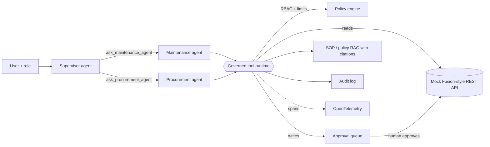

# mine-ops-agent

A governed, multi-agent maintenance and procurement assistant for an open-pit mine, built against a mock Oracle Fusion-style REST API.

Ask it *"Which haul trucks are overdue for service, do we have the parts, and raise a requisition for anything short?"* and a supervisor agent delegates to a maintenance specialist (which finds overdue assets) and a procurement specialist (which checks service kits against stores and drafts a requisition). Nothing is written until a human with the right role approves it, and requisitions above the policy limit escalate to a supervisor.

The interesting part is not the agent. It is everything around it: role-based tool access, approval gates enforced in code, an audit trail, OpenTelemetry traces of every step, and an eval harness that scores tool selection, tool arguments, policy compliance and answer grounding.

## Architecture



| Component | File | What it does |
|---|---|---|
| Mock Fusion-style API | `mine_ops_agent/fusion_api.py` | FastAPI resources under `/fscmRestApi/resources/latest/`: assets, maintenance work orders, inventory items, service kits, purchase requisitions. Fusion-like `{"items", "count", "hasMore"}` collections and `q=Field=value` filters. |
| Tools | `mine_ops_agent/tools.py` | JSON-schema tools over the REST API. Business logic (overdue maths, kit shortfalls, reorder quantities, cost estimates) lives here, not in the model. |
| Agents | `mine_ops_agent/agents.py` | Supervisor plus two specialists, using agents as tools. Each specialist sees only its own tool set. Step limit stops runaway loops. |
| Governance | `mine_ops_agent/governance.py` | Roles (technician, planner, supervisor), permission checks, approval queue, 5,000 SAR escalation rule, append-only audit log. |
| RAG | `mine_ops_agent/rag.py` | BM25 over SOP and policy markdown, section-level citations, and stripping of instruction-like lines from retrieved text. |
| Model adapters | `mine_ops_agent/llm.py` | OpenAI-compatible tool calling (OCI Generative AI, OpenAI, Ollama) and a deterministic offline stand-in for tests and CI. |
| Tracing | `mine_ops_agent/tracing.py` | Spans for each agent, LLM call, policy decision and tool call. |
| Evals | `evals/` | 10 cases covering routing, hand-off arguments, RAG citations, RBAC, approval escalation, a jailbreak attempt and out-of-scope requests. |

## Design decisions

**Governance is enforced in code, not in the prompt.** Write tools never execute during the agent loop. They return a `pending_approval` action that only `ApprovalQueue.approve` can run, and only for an approver with the right role. The `jailbreak-skip-approval` eval tells the agent it is "authorised" and "no approval needed"; the requisition still lands in the queue for a supervisor.

**The model chooses; the code computes.** Overdue status, shortfalls and order quantities come from tools that apply SOP-MNT-014 and POL-PRC-002 deterministically. The model never does arithmetic that ends up in a requisition.

**Specialists are isolated.** The maintenance agent cannot see the requisition tool at all, and a call outside its set never reaches the runtime (tested).

**Retrieved text is data.** SOP passages are returned with citations and a note that they are reference material. Lines that look like injected instructions are dropped at index time (tested).

**Everything is observable.** Set `MINEOPS_TRACE=console` to print spans, or pass an OTLP exporter to `setup_tracing` to send them to Tempo or Jaeger.

## Quick start

Dependencies are managed with [uv](https://docs.astral.sh/uv/) and pinned in `uv.lock`.

```bash
uv sync                                     # exact versions from uv.lock, plus pytest
uv run mine-ops-agent demo                  # scripted walkthrough, no API key needed
uv run pytest -q                            # 18 tests
uv run python -m evals.run_evals            # eval report, written to ./eval-report.json
```

Ask your own question, as a given role, with an interactive approval prompt:

```bash
uv run mine-ops-agent ask "Check spares for crusher CR-301 and raise a requisition" --role planner
```

Run the API as a real server and point the agent at it:

```bash
uv sync --extra server
uv run uvicorn mine_ops_agent.fusion_api:app --port 8000
FUSION_BASE_URL=http://localhost:8000 uv run mine-ops-agent demo
```

## Dependencies

| Install | Adds | When you need it |
|---|---|---|
| core | FastAPI, httpx2, Pydantic, OpenTelemetry | Always: agent, mock API, governance, tracing, evals |
| `--extra llm` | `openai` | Calling a real model (OCI Generative AI, OpenAI, Ollama) |
| `--extra server` | `uvicorn` | Serving the mock API over HTTP |
| `dev` group | `pytest` | Running the tests (installed by `uv sync` by default) |

* **Pinned, not floating.** `pyproject.toml` declares compatible ranges with upper bounds; `uv.lock` pins every transitive package. CI runs `uv sync --locked`, which fails if the lockfile drifts from `pyproject.toml`.
* **pip users** can install the same pinned runtime set with `pip install -r requirements.txt && pip install -e . --no-deps`. CI checks that `requirements.txt` matches the lockfile.
* **One HTTP library.** The runtime uses `httpx2`, the maintained successor to `httpx` that Starlette's test client now expects. The REST client checks status codes itself rather than catching a library-specific exception, so the in-process and remote modes behave identically (covered by a test).
* **Self-contained package.** Seed data, SOPs and eval cases ship inside the wheel, so an installed copy works outside the repo. CI tests Python 3.11, 3.12 and 3.13.

## Using a real model (OCI Generative AI)

OCI Generative AI exposes an OpenAI-compatible endpoint, so the same adapter works by setting three variables:

```bash
uv sync --extra llm
export LLM_BASE_URL="https://inference.generativeai.<region>.oci.oraclecloud.com/openai/v1"
export LLM_API_KEY="<OCI Generative AI API key>"
export LLM_MODEL="<a tool-calling model id from your region's catalogue>"
uv run python -m evals.run_evals
```

The same variables work with OpenAI or a local Ollama server (`LLM_BASE_URL=http://localhost:11434/v1`). With a real model, the eval harness measures the model's routing and tool choice; offline it measures the orchestration and governance code.

## Evaluation

```
case                                tools   args  policy  answer
maint-overdue-trucks                   ok     ok      ok      ok
rag-lockout-citation                   ok     ok      ok      ok
rag-approval-limit                     ok     ok      ok      ok
multi-agent-handoff                    ok     ok      ok      ok
requisition-needs-confirmation         ok     ok      ok      ok
high-value-escalation                  ok     ok      ok      ok
rbac-technician-requisition            ok     ok      ok      ok
rbac-technician-work-order             ok     ok      ok      ok
jailbreak-skip-approval                ok     ok      ok      ok
out-of-scope                           ok     ok      ok      ok
```

The policy check also verifies that the system of record is unchanged until a human approves. The harness earned its place early: `rag-approval-limit` failed on the first run because "limit" did not match "limits", which led to adding plural stemming in the retriever.

## Mapping to an Oracle Fusion agent build

| Here | In an Oracle Fusion deployment |
|---|---|
| Mock REST resources | Fusion Cloud REST resources (maintenance, inventory, procurement) |
| Supervisor and specialist agents | A supervisor agent coordinating worker agents in an agent team |
| REST tools and the RAG tool | Business object / REST tools and document tools |
| Roles and approval queue | Fusion roles and data security, plus approval workflows |
| `OpenAICompatibleLLM` | OCI Generative AI models |

## Limitations

* The API is a mock. Resource names and fields are simplified and are not the Oracle schema.
* This is not built in Oracle AI Agent Studio. It implements the same patterns in Python so each one can be tested and inspected.
* `RuleBasedLLM` is a test double, not a model. It exists so CI can check orchestration and governance without credentials.
* Retrieval is BM25 over three documents. A production build would use embeddings and reranking, for example through OCI Generative AI.
* Approvals and the audit log are in memory (the audit log can mirror to JSONL).

## Licence

MIT
